# 🚀 Visiology Widget Simulator

> 🤖 **AI-powered инструмент** для автоматизированной разработки кастомных виджетов платформы **Visiology** с помощью ИИ-агентов в **Cursor IDE**

---

## 📋 Оглавление

- [🌟 О проекте](#-о-проекте)
- [🏗️ Архитектура](#️-архитектура)
- [⚡ Быстрый старт](#-быстрый-старт)
- [🤖 Работа с ИИ-агентом](#-работа-с-ии-агентом)
- [📂 Структура виджета](#-структура-виджета)
- [🔌 HTTP API](#-http-api)
- [📊 Структура данных](#-структура-данных)
- [🎨 Шаблоны виджетов](#-шаблоны-виджетов)
- [💡 Советы и лайфхаки](#-советы-и-лайфхаки)
- [🐛 Отладка](#-отладка)
- [📦 Технологический стек](#-технологический-стек)
- [👥 Команда](#-команда)

---

## 🌟 О проекте

**Visiology Widget Simulator** — это локальная среда разработки, которая позволяет создавать, тестировать и отлаживать кастомные JavaScript-виджеты для BI-платформы **Visiology** 📊

Ключевая особенность — **полная интеграция с Cursor IDE**: ИИ-агент самостоятельно пишет код виджета, загружает его в симулятор, визуально проверяет результат через встроенный браузер и итеративно дорабатывает до готового состояния 🎯

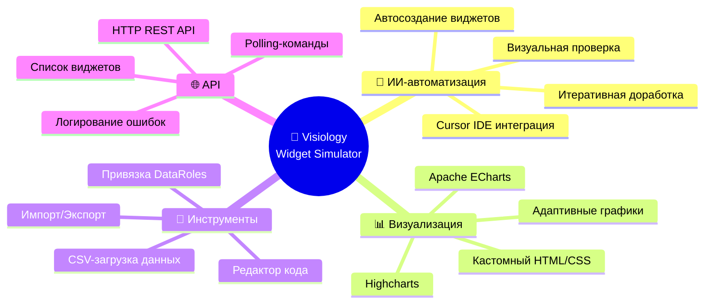

---

## 🏗️ Архитектура

### 🔄 Общая схема работы

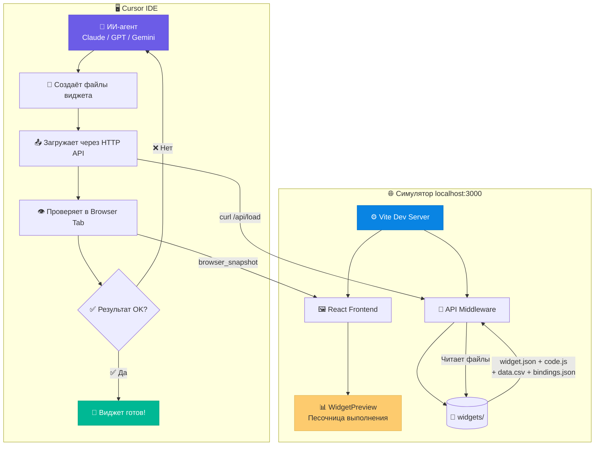

### 🧩 Компонентная архитектура фронтенда

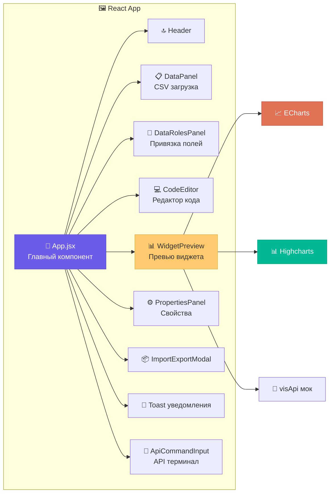

### 🔄 Жизненный цикл загрузки виджета

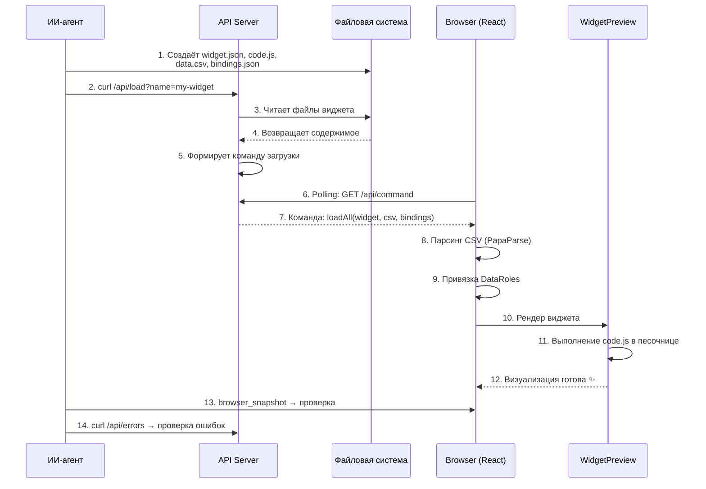

---

## ⚡ Быстрый старт

### 📋 Предварительные требования

| Инструмент | Версия | Описание |
|:---:|:---:|:---|
| 🟢 **Node.js** | 18+ | JavaScript runtime |
| 📦 **npm** | 9+ | Пакетный менеджер |
| 🖥️ **Cursor IDE** | Последняя | IDE с ИИ-агентами |

### 🔧 Шаг 1: Клонирование проекта

```bash
git clone <repository-url> visio-simulator
cd visio-simulator
```

### 📦 Шаг 2: Установка зависимостей

Откройте проект в **Cursor IDE** и выполните в терминале:

```bash
npm install
```

### 🚀 Шаг 3: Запуск симулятора

```bash
npm run dev
```

> ✅ Симулятор запустится на **http://localhost:3000**

### 🌐 Шаг 4: Открытие Browser Tab в Cursor

1. Откройте **Browser Tab** в Cursor IDE (встроенный браузер) 🖥️
2. Перейдите на **http://localhost:3000** 🌐
3. Убедитесь, что симулятор загрузился и отображает интерфейс ✅


---

## 🤖 Работа с ИИ-агентом

### 🧠 Выбор модели

Для работы с симулятором рекомендуется следующая стратегия выбора ИИ-модели:

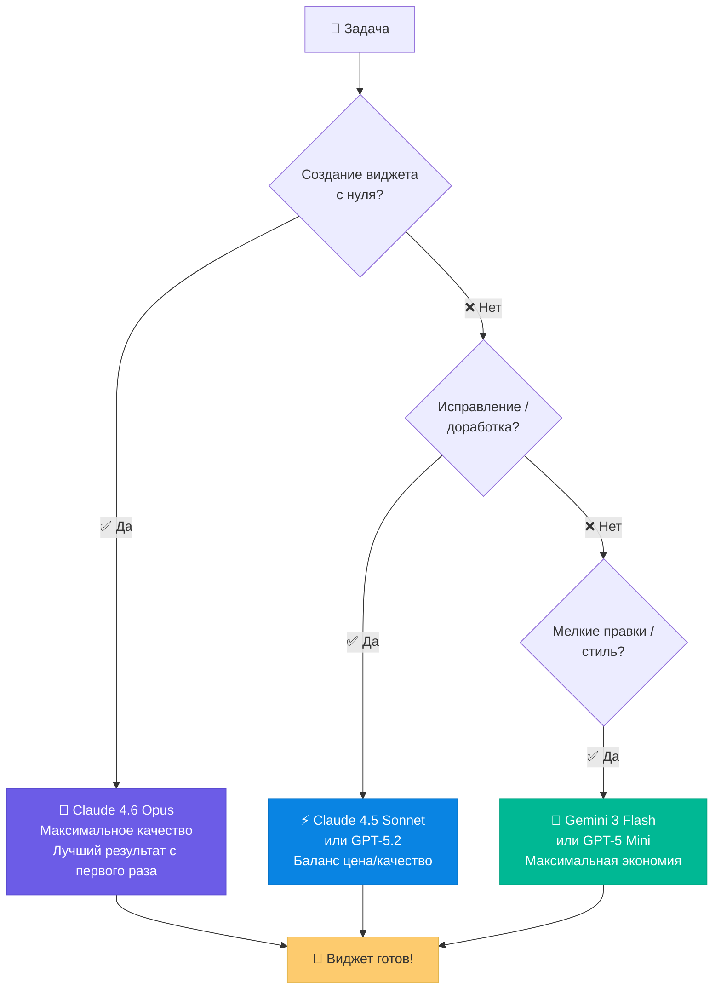

| Сценарий | Рекомендуемая модель | Стоимость | Качество |
|:---|:---|:---:|:---:|
| 🆕 Создание виджета с нуля | **Claude 4.6 Opus** | 💰💰💰 | ⭐⭐⭐⭐⭐ |
| 🔧 Доработка / исправление | **Claude 4.5 Sonnet** / **GPT-5.2** | 💰💰 | ⭐⭐⭐⭐ |
| ✏️ Мелкие правки, стили | **Gemini 3 Flash** / **GPT-5 Mini** | 💰 | ⭐⭐⭐ |

> 💡 **Совет:** Используйте **Opus 4.6** для создания виджета с нуля — он выдаёт наиболее качественный результат с первой попытки. Для последующих корректировок и доработок переключитесь на более экономичные модели.
>
> 💲 Актуальные цены на модели: **[cursor.com/docs/models — Model pricing](https://cursor.com/docs/models#model-pricing)**

### 📝 Пошаговая инструкция

#### 1️⃣ Подготовка промпта

Скопируйте или переместите файл `CURSOR_PROMPT.md` (системный промпт для ИИ-агента) в качестве контекста для агента.

#### 2️⃣ Формирование задачи

Напишите или вставьте **техническое задание** (ТЗ) на виджет в чат агента. Обязательно укажите:

```
📌 Симулятор уже запущен на http://localhost:3000 и открыт в Browser Tab.
📌 Создай виджет [название] по следующему ТЗ: ...
```

#### 3️⃣ Автоматическая работа агента

После получения задачи ИИ-агент **самостоятельно**:

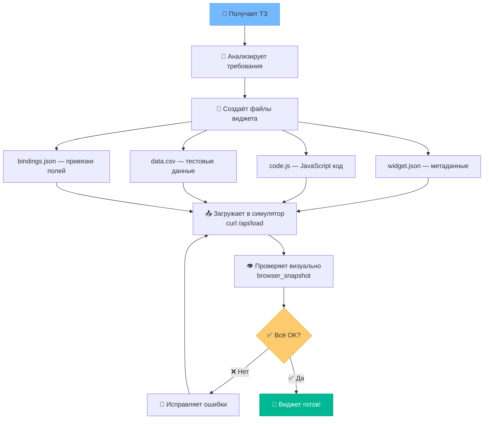

1. 📁 **Создаёт** папку виджета в `widgets/`
2. ✍️ **Пишет** код виджета (`code.js`)
3. 📊 **Генерирует** тестовые данные (`data.csv`)
4. 🔗 **Настраивает** привязки полей (`bindings.json`)
5. 📤 **Загружает** виджет через API симулятора
6. 👁️ **Проверяет** результат визуально через Browser Tab
7. 🐛 **Анализирует** ошибки, если есть
8. 🔄 **Итеративно дорабатывает** до идеального результата

---

## 📂 Структура виджета

Каждый виджет — это папка в директории `widgets/` со следующей структурой:

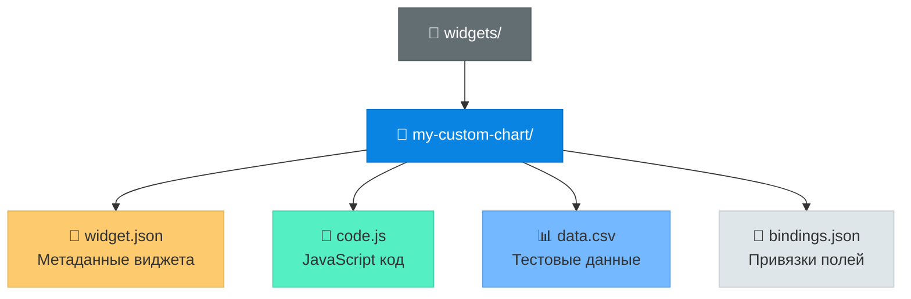

### 📄 widget.json — Метаданные

```json
{
  "Name": "My Custom Chart",
  "DataRoles": [
    {
      "Name": "category",
      "DisplayName": "Категория",
      "Description": "Поля группировки",
      "Kind": 0,
      "Optional": false
    },
    {
      "Name": "value",
      "DisplayName": "Значение",
      "Description": "Числовые поля",
      "Kind": 1,
      "Optional": false
    }
  ],
  "Properties": [
    {
      "DisplayName": "Цвет",
      "PropertyName": "color",
      "Value": "#00b4d8",
      "Type": 3
    }
  ]
}
```

### ⚠️ Только 2 роли данных (DataRoles)

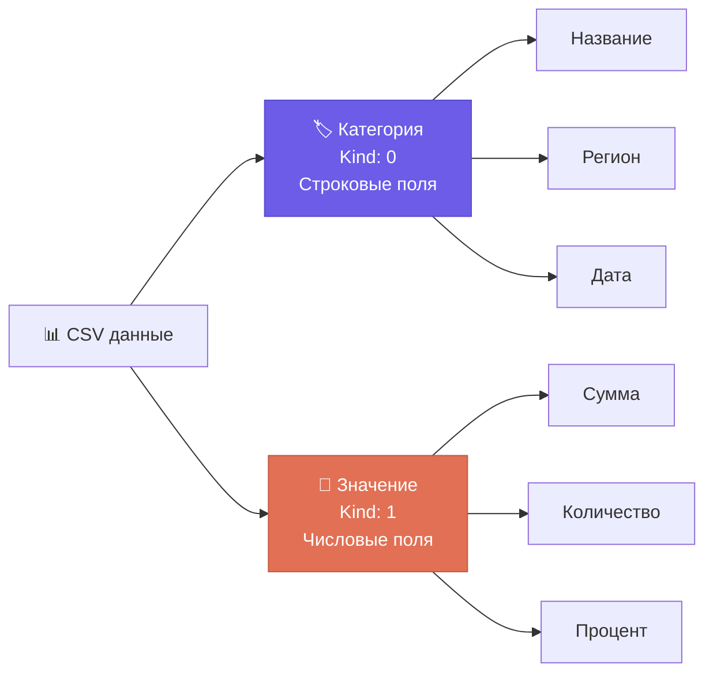

| Роль | Kind | Тип данных | Примеры полей |
|:---:|:---:|:---:|:---|
| 🏷️ **Категория** (Dimension) | `0` | Строки | Category, Segment, Name, Region |
| 🔢 **Значение** (Measure) | `1` | Числа | Value, Amount, Target, Percent |

### 📝 code.js — JavaScript код виджета

> ⚠️ **Важно:** код пишется в отдельном файле `code.js`, а **не** внутри `widget.json`!

```javascript
(function() {
  var container = document.getElementById(w.general.renderTo);
  var props = w.props || {};
  var items = w.data?.primaryData?.items || [];

  if (!items.length) {
    container.innerHTML = '<div style="color:#999;text-align:center;">Нет данных</div>';
    return;
  }

  // ... логика виджета ...

  var chart = echarts.init(container);
  chart.setOption({ /* опции */ });

  new ResizeObserver(() => chart.resize()).observe(container);
})();
```

### 📊 data.csv — Тестовые данные

```csv
Category,Segment,Value,Target
Продукт A,Высокий,100,120
Продукт A,Низкий,80,90
Продукт B,Высокий,150,140
```

### 🔗 bindings.json — Привязки полей

```json
{
  "category": ["Category", "Segment"],
  "value": ["Value", "Target"]
}
```

- `category` — массив строковых колонок CSV → Роль "Категория" 🏷️
- `value` — массив числовых колонок CSV → Роль "Значение" 🔢

---

## 🔌 HTTP API

Симулятор предоставляет REST API для программного управления:

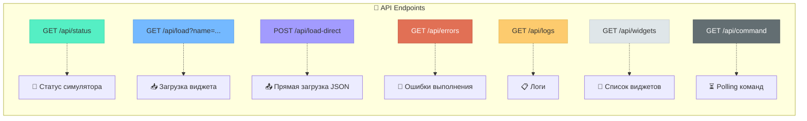

| Endpoint | Метод | Описание | Пример |
|:---|:---:|:---|:---|
| `/api/status` | 🟢 GET | Статус симулятора | `curl http://localhost:3000/api/status` |
| `/api/load?name=widget` | 🟢 GET | Загрузить виджет из `widgets/` | `curl "http://localhost:3000/api/load?name=my-chart"` |
| `/api/load-direct` | 🟡 POST | Загрузить виджет из JSON-тела | `curl -X POST -d '...' http://localhost:3000/api/load-direct` |
| `/api/errors` | 🟢 GET | Получить ошибки выполнения | `curl http://localhost:3000/api/errors` |
| `/api/logs` | 🟢 GET | Получить логи | `curl http://localhost:3000/api/logs` |
| `/api/widgets` | 🟢 GET | Список всех доступных виджетов | `curl http://localhost:3000/api/widgets` |
| `/api/command` | 🟢 GET | Polling ожидающих команд | Используется браузером |

---

## 📊 Структура данных

### 🗂️ Объект `w` — контекст виджета

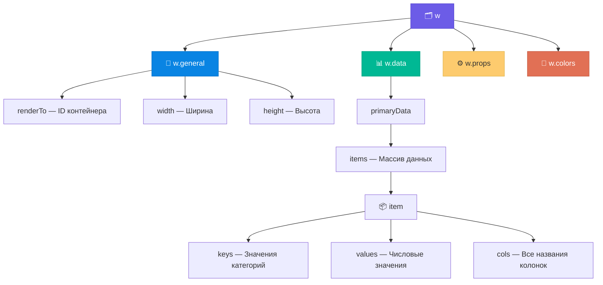

```javascript
// 📐 Общие параметры
w.general.renderTo      // ID контейнера для рендера
w.general.width         // Ширина виджета
w.general.height        // Высота виджета

// 📊 Данные
w.data.primaryData.items  // Массив данных

// ⚙️ Свойства
w.props                 // Пользовательские свойства виджета

// 🎨 Палитра
w.colors                // Массив цветов
```

### 📦 Структура элемента данных (item)

```javascript
{
  keys: ["Продукт A", "Высокий"],        // 🏷️ Значения категорий
  values: [100, 120],                     // 🔢 Числовые значения
  cols: ["Category", "Segment", "Value", "Target"],  // 📋 Все колонки
  formattedKeys: ["Продукт A", "Высокий"],  // 🏷️ Форматированные категории
  formattedValues: ["100", "120"]            // 🔢 Форматированные значения
}
```

### 📚 Доступные библиотеки

| Библиотека | Глобальная переменная | Описание |
|:---|:---|:---|
| 📈 Apache ECharts | `echarts` | Библиотека визуализации |
| 📊 Highcharts | `Highcharts` | Библиотека графиков |
| 🔧 Lodash | `lodash` / `_` | Утилиты |
| 🔮 Visiology API | `visApi()` | Эмуляция API платформы |

---

## 🎨 Шаблоны виджетов

### 📈 Базовый шаблон ECharts

```javascript
(function() {
  var container = document.getElementById(w.general.renderTo);
  var props = w.props || {};
  var items = w.data?.primaryData?.items || [];

  if (!items.length) {
    container.innerHTML = '<div style="display:flex;align-items:center;justify-content:center;height:100%;color:#999;">📊 Нет данных</div>';
    return;
  }

  var existingChart = echarts.getInstanceByDom(container);
  if (existingChart) existingChart.dispose();

  var categories = items.map(function(item) { return item.keys[0]; });
  var values = items.map(function(item) { return item.values[0]; });

  var chart = echarts.init(container);
  chart.setOption({
    backgroundColor: 'transparent',
    tooltip: { trigger: 'axis' },
    xAxis: { type: 'category', data: categories },
    yAxis: { type: 'value' },
    series: [{
      type: 'bar',
      data: values,
      itemStyle: { color: props.color || '#00b4d8' }
    }]
  });

  new ResizeObserver(function() { chart.resize(); }).observe(container);
})();
```

### 🥧 Шаблон круговой диаграммы

```javascript
(function() {
  var container = document.getElementById(w.general.renderTo);
  var items = w.data?.primaryData?.items || [];

  if (!items.length) {
    container.innerHTML = '<div style="color:#999;text-align:center;padding:20px;">🥧 Нет данных</div>';
    return;
  }

  var existing = echarts.getInstanceByDom(container);
  if (existing) existing.dispose();

  var data = items.map(function(item, i) {
    return {
      name: item.keys[0],
      value: item.values[0],
      itemStyle: { color: w.colors[i % w.colors.length] }
    };
  });

  var chart = echarts.init(container);
  chart.setOption({
    backgroundColor: 'transparent',
    tooltip: { trigger: 'item' },
    legend: { orient: 'vertical', left: 'left', textStyle: { color: '#9aa0a6' } },
    series: [{ type: 'pie', radius: '60%', data: data }]
  });

  new ResizeObserver(function() { chart.resize(); }).observe(container);
})();
```

---

## 💡 Советы и лайфхаки

### 🎯 Стратегия использования моделей

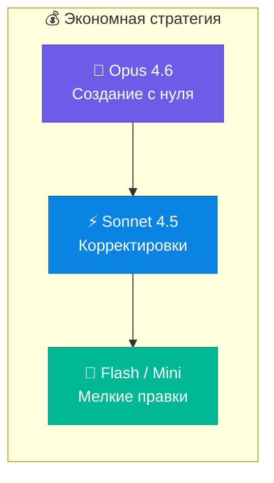

> 🧠 **Opus 4.6** → для создания виджета с нуля (лучшее качество)
>
> ⚡ **Sonnet 4.5 / GPT-5.2** → для исправлений и доработок
>
> 💨 **Flash / Mini** → для косметических правок

### 🚀 Параллельное создание виджетов

Если нужно создать **много виджетов**, можно попросить ИИ-агента использовать **параллельные субагенты**:

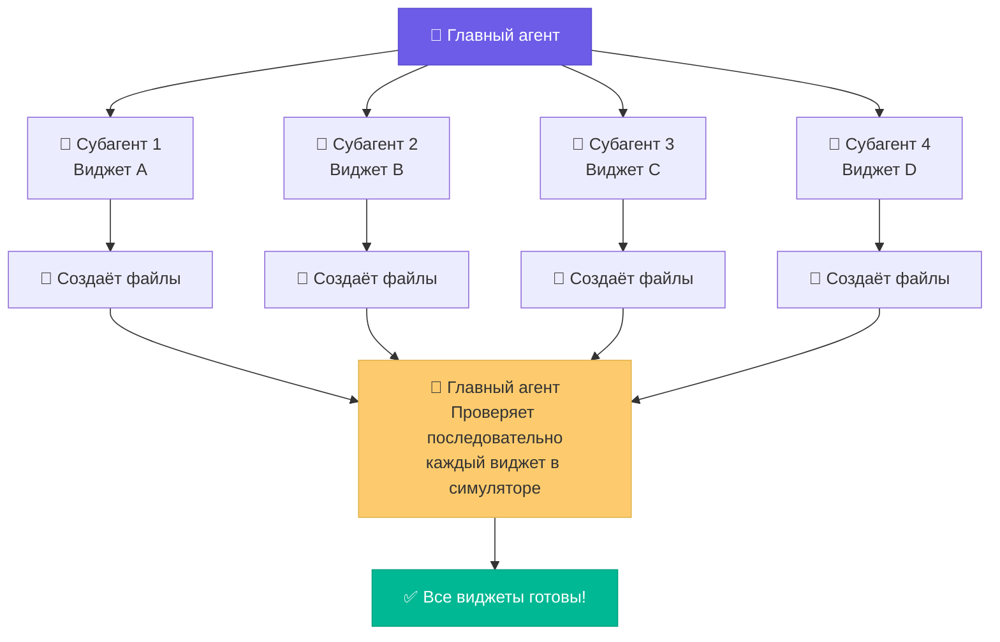

> 💡 **Tip:** Попросите агента создать виджеты параллельно через субагенты, но **без проверки в симуляторе** каждым субагентом. После создания всех файлов — проверьте каждый виджет **последовательно** в симуляторе. Это значительно ускоряет процесс! 🏎️

### 📝 Чеклист для создания виджета

```
✅ Создать папку widgets/название-виджета/
✅ Создать widget.json с метаданными (DataRoles, Properties)
✅ Создать code.js с JavaScript-кодом виджета
✅ Создать data.csv с тестовыми данными
✅ Создать bindings.json с привязками полей
✅ curl "http://localhost:3000/api/load?name=название-виджета"
✅ Проверить результат в Browser Tab
✅ curl "http://localhost:3000/api/errors" → проверить ошибки
✅ Исправить ошибки (если есть) и повторить
```

### ⚠️ Важные правила при написании кода виджета

1. 🛡️ **Всегда проверяй наличие данных:**
   ```javascript
   if (!w.data?.primaryData?.items?.length) { return; }
   ```

2. 🧹 **Очищай предыдущий chart:**
   ```javascript
   var existing = echarts.getInstanceByDom(container);
   if (existing) existing.dispose();
   ```

3. 📦 **Оборачивай код в IIFE:**
   ```javascript
   (function() { /* ... */ })();
   ```

4. 📐 **Добавляй ResizeObserver для адаптивности:**
   ```javascript
   new ResizeObserver(() => chart.resize()).observe(container);
   ```

---

## 🐛 Отладка

| Проблема | Причина | Решение |
|:---|:---|:---|
| 📭 "Нет данных" | Неверные привязки | Проверьте `bindings.json` и `data.csv` |
| 🖼️ График не появляется | Размеры контейнера = 0 | Добавьте `setTimeout`, проверьте `renderTo` |
| ❌ Ошибка в коде | Синтаксис / логика | `curl http://localhost:3000/api/errors` |
| 📂 Виджет не загружается | Нет файлов | `curl http://localhost:3000/api/widgets` |
| 🔄 Не обновляется | Кеш команд | Перезагрузите страницу симулятора |

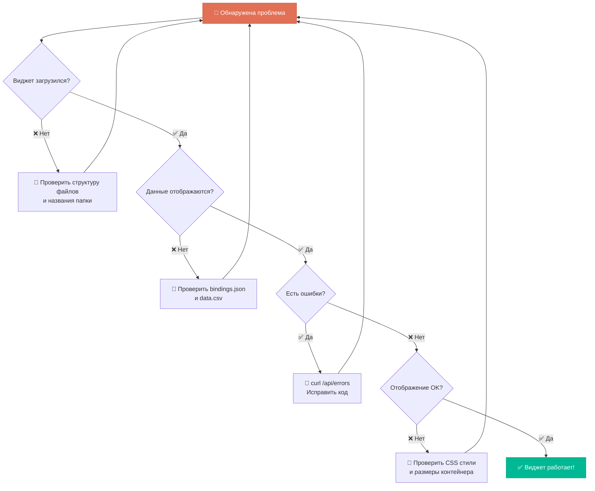

---

## 📦 Технологический стек

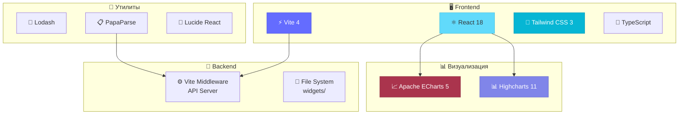

| Категория | Технология | Версия |
|:---|:---|:---:|
| ⚛️ UI Framework | React | 18.2 |
| ⚡ Build Tool | Vite | 4.4 |
| 🎨 Стили | Tailwind CSS | 3.3 |
| 📈 Графики | Apache ECharts | 5.4 |
| 📊 Графики | Highcharts | 11.4 |
| 🔧 Утилиты | Lodash | 4.17 |
| 📋 CSV парсинг | PapaParse | 5.4 |

---

## 🔮 Эмуляция Visiology API

Симулятор предоставляет мок `visApi()` с поддержкой:

| Метод | Описание |
|:---|:---|
| 🔍 `getSelectedValues()` | Получить выбранные значения фильтров |
| 🎛️ `setFilterSelectedValues()` | Установить фильтры |
| 📊 `drillDown()` / `drillUp()` | Drill-down навигация |
| 📢 `onSelectedValuesChangedListener()` | Подписка на изменения |
| 📤 `exportDashboard()` | Экспорт дашборда |
| 🌍 `getLocale()` | Получить локаль |
| 🎨 `getTheme()` | Получить тему |

---

## 🌟 Важный момент

> 🧪 **Всё приходит с опытом** — пробуйте, экспериментируйте, адаптируйте и обязательно **улучшите и ускорите процесс под себя!**
>
> Каждая команда и проект уникальны. Не бойтесь менять подходы, комбинировать модели, настраивать промпты и искать свой идеальный workflow. Результаты будут улучшаться с каждой итерацией! 🚀

---

## 📜 Скрипты

```bash
# 🚀 Запуск dev-сервера (http://localhost:3000)
npm run dev

# 📦 Сборка для продакшена
npm run build

# 👁️ Превью собранного билда
npm run preview
```

---

## 👥 Команда

<div align="center">

### 🏢 Сделано командой FatData по заказу Visiology

### 👨‍💼 Руководитель проекта: Чжен Артём

</div>

---

<div align="center">

🤖 **Visiology Widget Simulator** — Автоматизация разработки виджетов с помощью ИИ

⭐ Если проект полезен — поставьте звезду!

</div>
